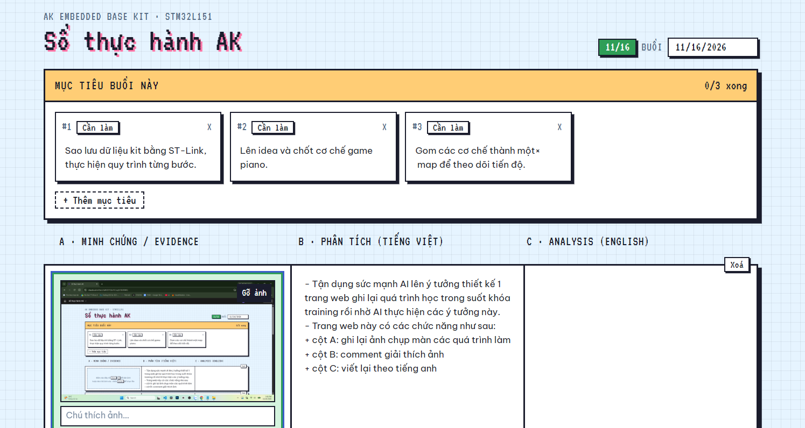
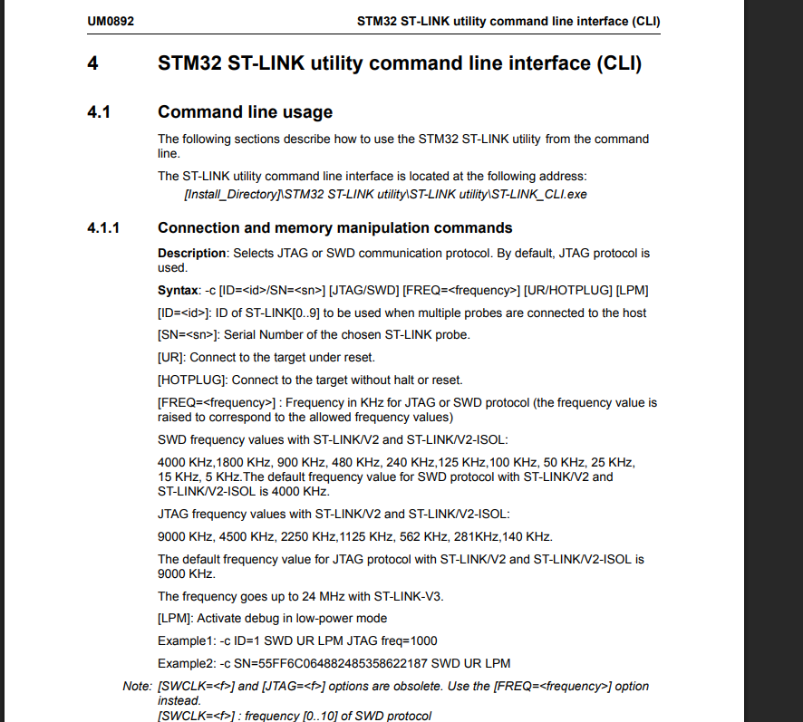
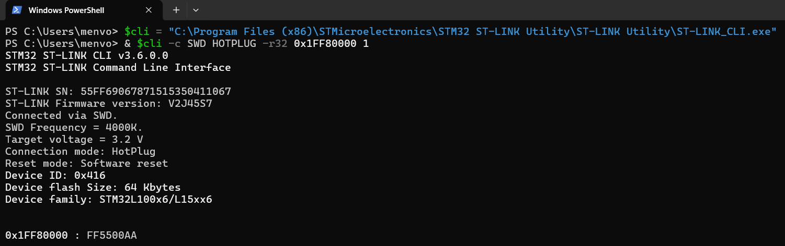
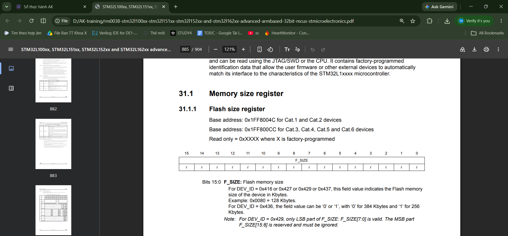

# 2026-11-17

## Mục tiêu
- [x] Sao lưu dữ liệu kit bằng ST-Link, thực hiện quy trình từng bước.
- [x] Lên idea và chốt cơ chế game piano.
- [ ] Gom các cơ chế thành một map để theo dõi tiến độ.

## Web note ghi lại quá trình học

<table><tr>
<td width="50%"></td>
<td>
- Tận dụng sức mạnh AI lên ý tưởng thiết kế 1 trang web ghi lại quá trình học trong suốt khóa training rồi nhờ AI thực hiện các ý tưởng này. 
- Trang web này có các chức năng như sau: 
+ cột A: ghi lại ảnh chụp màn các quá trình làm 
+ cột B: comment giải thích ảnh 
+ cột C: viết lại theo tiếng anh
</td>
</tr></table>

## Cú pháp lệnh từ tài liệu nhà sản xuất (UM0892)

<table><tr>
<td width="50%"></td>
<td>
UM0892 
– mục 4.1.1, trang 35: 
+ cú pháp lệnh -c của ST-LINK_CLI. 
+ SWD: giao thức 2 dây (mặc định là JTAG nên phải ghi rõ) 
+ HOTPLUG: kết nối không dừng, không reset chip 
→ Giải thích vì sao kit vẫn chạy game khi kết nối
</td>
</tr></table>

## Kết quả chạy lệnh đọc thông tin chip và khóa RDP

<table><tr>
<td width="50%"></td>
<td>
- Chạy lệnh: 
( -c SWD HOTPLUG) 
=> kiểm tra thông tin phần cứng 
- Device ID: 0x416 
- Điện áp: 3.2V => chip hoạt động ổn 
- Bộ nhớ flash của chip thông báo: 64KB 
- Kiểm tra khóa: 0x1FF80000 : FF5500AA 
(1111 1111 0101 0101 0000 0000 1010 1010B) 
+AA: 1010 1010B => RDP=AA:khóa đang ở level 0 cho phép sao lưu trước khi nạp chương trình mới 
+00: 0000 0000B 
+55: 0101 0101B => bản đảo bit của AA dùng để kiểm tra lỗi khi khởi động 
+FF: 1111 1111B => tương tự với 55 đi kèm với 00 để kiểm tra lỗi lẫn nhau khi khởi động
</td>
</tr></table>

## Đối chiếu thanh ghi Flash size trong tài liệu kỹ thuật (RM0038)

<table><tr>
<td width="50%"></td>
<td>
RM0038 
– mục 31.1.1, trang 885: Flash size register tại 0x1FF8004C 
- Thanh ghi 16 bit, chỉ đọc (r), giá trị do nhà máy ghi sẵn, đơn vị KB. 
- Với Device ID 0x416: 0x0040 = 64 KB. 
→ Giải thích dòng Device flash Size: 64 Kbytes ở ảnh 2.
</td>
</tr></table>
